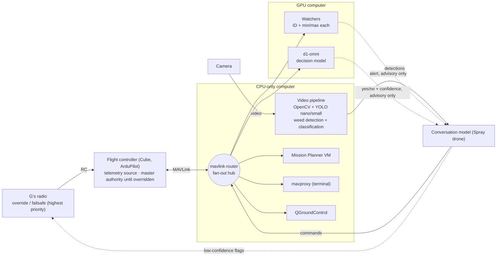

# Architecture

One-glance view of the stack. Source of truth: [DECISIONS.md](DECISIONS.md). Updated 23 Oct 2026.

**Rules**
- Decision models and watchers advise only. They never command the drone. The conversation model acts on high-confidence answers and flags low-confidence ones to G.
- G's radio overrides everything. The failsafe fires on whichever trigger comes first.
- mavlink-router logs who said what.

**Mission shape**
- A four-corner paddock waypoint file, with cameras looking along the fence line and inwards. A crosshatch pattern is optional.
- **Auto** mode for the survey, then **Guided** mode when a potential target is spotted. Either G or the conversation model can take the sticks.
