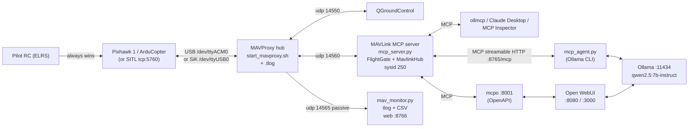

# LLM behind the sticks: MAVProxy + MAVLink MCP + Ollama

Status: **2026-10-25, first working version.** Tested end to end in ArduCopter
SITL 4.7.2 (see "What has been tested"). Not yet flown on the Pixhawk 1.
Where this disagrees with [DECISIONS.md](DECISIONS.md), DECISIONS.md wins.

Scope: a local LLM (Ollama, CPU) can **read** the vehicle and **ask** it to
do a small set of flight actions, through one gated MCP server. Out of scope
for now: spraying, weed ID, waypoint optimisation, offline maps, and failsafes
(ArduPilot on the Pixhawk handles failsafes: RC, battery, GCS and fence).

## Authority order (unchanged)

1. **The pilot's RC (ELRS) always wins.** Any mode change the LLM did not
   make is treated as a pilot takeover; the LLM is locked out until the
   operator clears it.
2. **ArduPilot failsafes and fence** on the flight controller.
3. **FlightGate** (`safety_gate.py`): deterministic Python, no LLM inside.
4. The LLM. It only ever calls named tools; it never writes raw MAVLink, RC
   overrides or arbitrary parameters.

## Data flow



MAVProxy is the only program that opens the FC link. Everything else is a
UDP client of MAVProxy. `config/mavlink-router.conf` is an alternative hub on
the same ports: run **one** of the two, never both.

## Ports

| Port | Proto | Who | Notes |
|---|---|---|---|
| 5760 | TCP | SITL | MAVProxy connects to it (`run_sitl.sh`) |
| 14550 | UDP | QGroundControl | QGC auto-connects |
| 14560 | UDP | MAVLink MCP server | `udpin:127.0.0.1:14560` |
| 14565 | UDP | data-flow monitor | passive, never transmits |
| 14551 | UDP | legacy `agent.py`/`tools.py` | only if `EXTRA_OUTS=udp:127.0.0.1:14551` |
| 8765 | HTTP | MCP server | `http://127.0.0.1:8765/mcp` (streamable HTTP; `--transport sse` also available) |
| 8766 | HTTP | monitor | `/` dashboard, `/api/snapshot` JSON |
| 8001 | HTTP | mcpo | OpenAPI for Open WebUI (`/docs`) |
| 8000 | HTTP | `/workspace/local-agent` | **taken**, which is why mcpo is on 8001 |
| 8080 | HTTP | Open WebUI from `setup-local-ai.sh` | unchanged |
| 3000 | HTTP | Open WebUI from `drone_stack/docker-compose.yml` | unchanged |
| 11434 | HTTP | Ollama | unchanged |

Everything binds to 127.0.0.1 by default. Do not expose 8765 or 8001 on a
network: they can fly the aircraft.

## Components

| File | Purpose |
|---|---|
| `drone_stack/bringup.sh` | One command: `sitl` / `pixhawk` / `radio` [`--webui`], `status`, `stop` |
| `drone_stack/sitl/run_sitl.sh` | ArduCopter SITL (sim_vehicle.py if you have ardupilot, else the prebuilt binary) |
| `drone_stack/mavproxy/start_mavproxy.sh` | MAVProxy hub + port fan-out + serial sanity checks |
| `drone_stack/middleware/mcp_server.py` | MAVLink MCP server (official `mcp` SDK, FastMCP) |
| `drone_stack/middleware/drone_tools.py` | The 22 tools (transport independent), system prompt |
| `drone_stack/middleware/safety_gate.py` | `FlightGate` (+ legacy spray `SafetyGate`) |
| `drone_stack/middleware/mavlink_hub.py` | The **only** COMMAND_LONG / SET_POSITION_TARGET / PARAM_SET / mission writer |
| `drone_stack/middleware/mav_node.py` | Telemetry reader (status, message buffers, link stats) |
| `drone_stack/middleware/link_stats.py` | Per-source sequence-gap loss and message rates |
| `drone_stack/middleware/stack_config.py` | TOML profile loader + defaults |
| `drone_stack/middleware/mcp_agent.py` | Ollama CLI agent that uses the MCP server |
| `drone_stack/middleware/mav_monitor.py` | Data-flow monitor: dashboard, tlog, CSV, web |
| `drone_stack/middleware/fake_vehicle.py` | Tiny MAVLink "vehicle" for tests without SITL |
| `config/llm_stack.sitl.toml` / `llm_stack.pixhawk.toml` | Profiles: limits, confirm mode, allowlist |
| `drone_stack/openwebui/` | mcpo config, Open WebUI steps, Claude Desktop example |
| `drone_stack/systemd/` | systemd *user* units + `install.sh` |

## Setup (Ubuntu / Mint)

```bash
cd precision-drone-spraying
python3 -m venv drone_stack/.venv
drone_stack/.venv/bin/pip install -r drone_stack/middleware/requirements.txt
sudo usermod -aG dialout $USER            # serial access, then log out/in
sudo systemctl mask --now ModemManager    # it grabs /dev/ttyACM0

# LLM (CPU Ollama on the Xeon). setup-local-ai.sh already installs Ollama
# (and Open WebUI on :8080 with --with-docker); otherwise:
curl -fsSL https://ollama.com/install.sh | sh
ollama pull qwen2.5:7b-instruct           # default; qwen2.5:3b for a quick test
```

On the 40-core Xeon set `OLLAMA_NUM_THREAD` (or `--num-thread`) to the number
of **physical** cores; 7B Q4 answers a tool call in a few seconds.
Model choice is config, not code: `--model`, or `OLLAMA_MODEL`.

## Bring-up

### 1. SITL (do this first, every time something changes)

```bash
drone_stack/bringup.sh sitl            # SITL + MAVProxy + MCP + monitor
drone_stack/bringup.sh status
qgroundcontrol.AppImage &              # optional, sees udp 14550
drone_stack/.venv/bin/python drone_stack/middleware/mcp_agent.py --approve
#  you> take off to 10 m and fly 30 m north
drone_stack/.venv/bin/python drone_stack/middleware/mav_monitor.py --url udpin:127.0.0.1:14565
#   (stop the headless monitor first, or use http://127.0.0.1:8766)
drone_stack/bringup.sh stop
```

`SITL_HOME=lat,lon,alt,hdg` sets the start position; `SITL_SPEEDUP=1`
default. Add `--webui` to start mcpo for Open WebUI
([../drone_stack/openwebui/README.md](../drone_stack/openwebui/README.md)).

SITL note: `rc 3 1500` in the MAVProxy console before using LOITER. LOITER
follows the throttle stick, and SITL's simulated stick sits at 1000, so the
copter descends. `hold` uses a GUIDED position hold when it can, to avoid this.

### 2. Pixhawk 1: the ladder

Never skip a rung. G on the radio for every powered step.

1. **Read-only, props off.** `config/llm_stack.pixhawk.toml` ships with
   `actuation_enabled = false`, `dry_run = true`.
   `drone_stack/bringup.sh pixhawk` (or `radio` for the SiK). Ask the agent
   for status, telemetry, params, mission. Check the monitor shows 0 % loss.
2. **Dry run, props off.** Set `actuation_enabled = true` (keep
   `dry_run = true`). Every action goes through the full gate and returns
   `would_send` instead of transmitting. Check the refusals (alt, fence,
   speed, params) look right.
3. **Bench, props off.** `dry_run = false`. Mode changes, arm/disarm with
   the operator code. Flip the pilot to LOITER/STABILIZE on the radio and
   confirm the server latches `pilot_override`.
4. **Paddock, props on, tethered or low.** `max_alt_m` 5, small fence, G
   holding the sticks, then widen the limits slowly.

## The MCP tools

Read-only (always allowed): `get_status`, `get_telemetry`, `get_data_flow`,
`get_recent_messages`, `get_params`, `get_mission`, `get_safety_limits`.

Safe actions (allowed even under pilot override, no confirmation):
`hold` (GUIDED position hold or LOITER), `brake`, `land`, `rtl`.

Gated actions: `set_mode` (whitelisted modes), `arm`*, `disarm`, `takeoff`*,
`goto`, `goto_relative`, `set_speed`, `set_param`*, `upload_mission`*,
`start_mission`*, `clear_pilot_override`*. (* = needs a confirm token.)

Prompt: `flight_rules` (the system prompt clients should use).

## Safety notes

* **Gate order:** actuation enabled → link fresh → pilot override / RC
  inhibit → rate limit → envelope (alt, geofence radius from home, speed,
  battery, GPS, RC link, param allowlist and range) → confirmation.
* **Confirmations** are single-use tokens bound to the action **and its
  arguments**, with a TTL. `echo` mode (SITL) returns the token to the LLM;
  `operator` mode (Pixhawk) only prints it on the server console, the monitor
  and `logs/llm-stack/confirmations.jsonl`, so a human must type it.
* **Pilot override:** any mode change not made by the server latches a
  lock-out (only safe actions still work) until `clear_pilot_override` with
  confirmation. Optional RC inhibit switch: `llm_inhibit_rc_channel`.
* **Parameters:** only the allowlist, each with a range. Names differ by
  firmware: ArduCopter ≤ 4.6 (likely the Pixhawk 1) uses `WPNAV_SPEED`,
  `RTL_ALT`, `LAND_SPEED` (cm, cm/s); 4.7+ (SITL stable) uses `WP_SPD`,
  `RTL_ALT_M`, `LAND_SPD_MS` (m, m/s). Both are allowlisted. Failsafe, fence,
  arming and frame params are never writable.
* **GCS failsafe (Trap 1):** ArduPilot's GCS failsafe follows heartbeats from
  `SYSID_MYGCS` (255): MAVProxy and QGC. The MCP server is sysid 250 and the
  monitor 252, so a crashed LLM stack does **not** trip the GCS failsafe while
  MAVProxy runs. That is deliberate (the pilot is the backstop), but it is an
  open decision.
* Logs: `logs/llm-stack/` (actions, confirmations), `logs/monitor/` (tlog +
  CSV), `logs/mavproxy/` (MAVProxy tlog). All git-ignored.

## What has been tested (2026-10-25)

Real, against ArduCopter SITL 4.7.2 via MAVProxy and MCP streamable HTTP:
set_mode, arm with confirmation, takeoff (50 m refused, 10 m OK),
goto_relative (500 m refused by the fence, 30 m N / 20 m E arrived),
set_speed, set_param (FS_GCS_ENABLE refused, out-of-range refused, in range
with confirmation OK), mission upload with a point outside the fence refused,
in-fence upload + read-back + start_mission, pilot override from a sysid 255
mode change (latched, goto blocked, hold allowed, clear with confirmation),
rtl, hold, land and disarm. Dry-run returns `would_send`. Monitor at ~270
msg/s with 0 loss, tlog readable by `mavlogdump.py`. mcpo exposes all 22
tools on :8001 and the gate still refuses a 99 m takeoff through it.

Real Ollama (qwen2.5:3b, CPU) through `mcp_agent.py`: it called
`get_status` and answered correctly; asked to arm and take off to 50 m it
switched to GUIDED, called `arm` and stopped at the confirmation, asking for
the operator. The 7B default was not pulled on the test box.

`pytest drone_stack/middleware/tests` (54 tests): gate unit tests, tool
schemas, a fake MAVLink vehicle over real UDP, an in-memory MCP session, and
the agent loop with a **scripted (mocked) Ollama**.

Not tested: real Pixhawk, SiK radio, Docker profile, systemd units, Open
WebUI UI itself (only mcpo's API), Claude Desktop.

## Open decisions

1. Who owns the GCS failsafe heartbeat (MAVProxy / QGC / the MCP server)?
2. MAVProxy vs mavlink-router as the hub (both configs exist; pick one).
3. `operator` confirmations for hardware: is the console/monitor code enough,
   or do we want a hardware button / radio switch?
4. Which RC channel is the "LLM inhibit" switch (`llm_inhibit_rc_channel`)?
5. Default model on the Xeon: qwen2.5:7b-instruct vs a larger 14B/32B.
